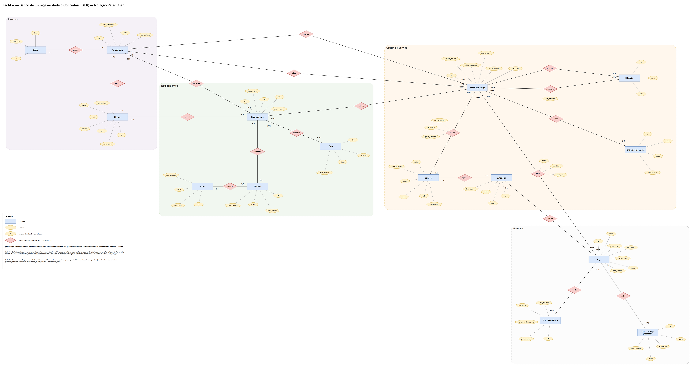
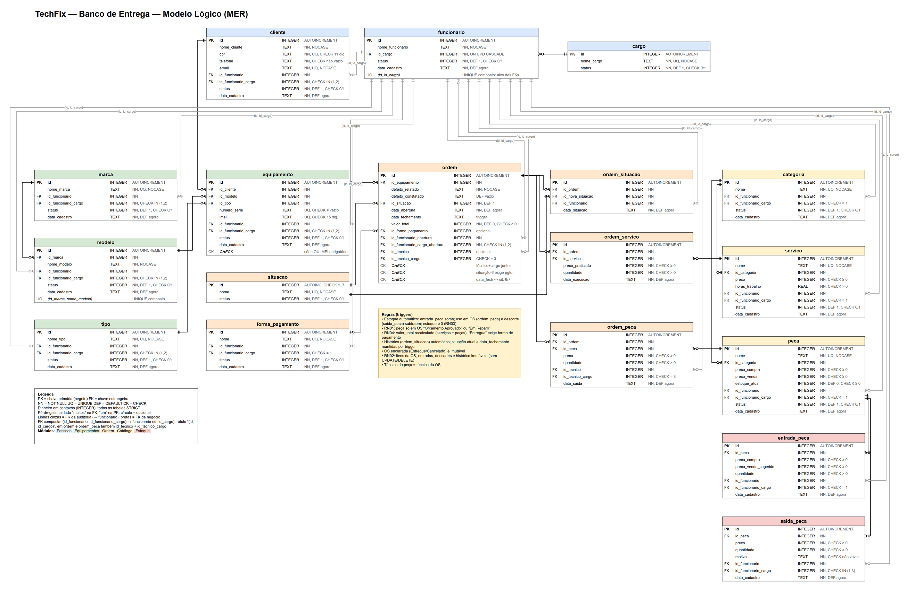
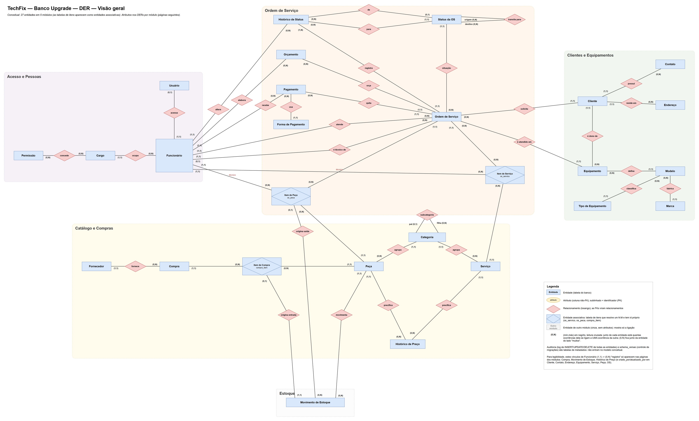
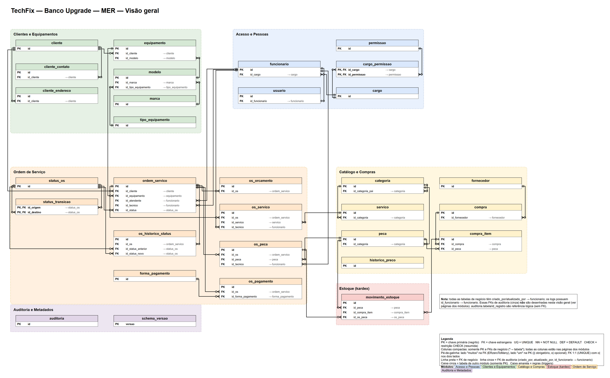

# TechFix — Sistema de Gestão de Assistência Técnica (Banco de Dados)

Projeto de banco de dados para uma assistência técnica de eletrônicos: cadastro de clientes e equipamentos, ordens de serviço com histórico de situação, catálogo de serviços e peças e controle de estoque. O banco foi modelado em SQLite e atende os requisitos RF01–RF11 e as regras de negócio RN01–RN04 do briefing.

## Bancos

| Banco | Pasta | Papel | Tabelas | Triggers | Views | Script único |
|---|---|---|---|---|---|---|
| Entrega | [banco_entrega/](banco_entrega/) | Banco de entrega da atividade | 18 | 22 | 3 | [techfix_entrega_completo.sql](banco_entrega/techfix_entrega_completo.sql) |
| Upgrade | [banco_upgrade/](banco_upgrade/) | Evolução com recursos de nível produção | 31 (+58 índices) | 107 | 8 | [techfix_upgrade_completo.sql](banco_upgrade/techfix_upgrade_completo.sql) |

O **Banco de Entrega** cobre tudo o que a atividade pede: as regras RN01–RN04 são garantidas pelo próprio banco (CHECKs e triggers), o estoque e o total da OS são calculados automaticamente e o histórico financeiro é imutável. É o banco da entrega da atividade.

O **Banco Upgrade** parte do mesmo domínio e vai além: acesso por permissões de cargo, auditoria em JSON, razão de estoque (kardex) com custo médio, máquina de estados da OS, orçamento, pagamentos múltiplos e parcelados, garantia e compras com fornecedor. Mostra como o modelo cresceria em um ambiente real.

## Onde está cada documento

| Documento | Onde | Para que serve |
|---|---|---|
| Requisitos (PDF) | [docs/requisitos/Atividade BD - TechFix.pdf](docs/requisitos/Atividade%20BD%20-%20TechFix.pdf) | O briefing original da atividade, com os RF e as RN |
| Especificação do Entrega | [docs/especificacao_entrega.md](docs/especificacao_entrega.md) | Explica o modelo e cada decisão tomada, tabela por tabela |
| Especificação do Upgrade | [docs/especificacao_upgrade.md](docs/especificacao_upgrade.md) | O mesmo para o banco com recursos de nível produção |
| Dicionário do Entrega | [docs/dicionario_de_dados_entrega.xlsx](docs/dicionario_de_dados_entrega.xlsx) | Cada coluna, tipo e restrição das 18 tabelas |
| Dicionário do Upgrade | [docs/dicionario_de_dados_upgrade.xlsx](docs/dicionario_de_dados_upgrade.xlsx) | Idem para as 31 tabelas, mais abas de triggers, views e índices |
| DER/MER do Entrega | [DER (.drawio)](modelos/entrega/DER_entrega_techfix.drawio), [DER (.png)](modelos/entrega/DER_entrega_techfix.png), [MER (.drawio)](modelos/entrega/MER_entrega_techfix.drawio), [MER (.png)](modelos/entrega/MER_entrega_techfix.png) | O desenho conceitual (DER) e o lógico (MER) do banco de entrega |
| DER/MER do Upgrade | [DER (.drawio)](modelos/upgrade/DER_upgrade_techfix.drawio), [MER (.drawio)](modelos/upgrade/MER_upgrade_techfix.drawio) e as páginas `.png` em [modelos/upgrade/](modelos/upgrade/) | Os diagramas do upgrade, divididos por módulo para caberem na tela |
| Scripts SQL por partes | [banco_entrega/](banco_entrega/) (`01` a `04`) e [banco_upgrade/](banco_upgrade/) (`01` a `05`) | Tabelas, regras, auditoria, views e dados em arquivos separados, para ler com calma |
| Script completo | [techfix_entrega_completo.sql](banco_entrega/techfix_entrega_completo.sql) e [techfix_upgrade_completo.sql](banco_upgrade/techfix_upgrade_completo.sql) | Tudo em um arquivo só: é por ele que se cria o banco |
| Banco `.sqlite` | [techfix_entrega.sqlite](banco_entrega/techfix_entrega.sqlite) e [techfix_upgrade.sqlite](banco_upgrade/techfix_upgrade.sqlite) | O banco já pronto e populado, para abrir direto |
| Artefatos de desenvolvimento | [desenvolvimento/](desenvolvimento/) | Rascunhos, DDL MySQL v1 e dicionário v1 de cada etapa, guardados como eram |
| Histórico | [HISTORICO.md](HISTORICO.md) | A linha do tempo do projeto, com as datas reais de cada fase |

## Como criar o banco

Use sempre o **script único** da versão desejada (`techfix_entrega_completo.sql` ou `techfix_upgrade_completo.sql`). Ele apaga e recria tudo, então pode ser executado quantas vezes quiser.

- **DB Browser for SQLite:** `Arquivo > Novo banco de dados`, cancele o assistente de tabela, abra a aba **Executar SQL**, abra o arquivo `*_completo.sql`, execute tudo (Ctrl+Enter) e use **Gravar alterações** (Ctrl+S).
- **SQLiteStudio:** crie um banco, abra o editor SQL, carregue o `*_completo.sql` e execute (F9).
- **Linha de comando:**

```
sqlite3 techfix.sqlite < banco_entrega/techfix_entrega_completo.sql
```

- **Sem executar nada:** abra direto o `.sqlite` pronto da pasta do banco.

Lembretes: use `PRAGMA foreign_keys = ON;` em cada conexão (o SQLite não ativa por padrão) e lembre que todos os valores em dinheiro são guardados em **centavos** (`INTEGER`).

## Requisitos atendidos

Resumo; os detalhes (tabelas, colunas e triggers) estão nos READMEs de [banco_entrega/](banco_entrega/README.md) e [banco_upgrade/](banco_upgrade/README.md).

| Requisito | Entrega | Upgrade | Onde |
|---|---|---|---|
| RF01 — Gestão de funcionários | ✔ | ✔ | Cargo e funcionário; no upgrade, também permissões e usuário |
| RF02 — Cadastro de clientes | ✔ | ✔ | Cliente (CPF único; só atendente ou gerente); no upgrade, contatos e endereços |
| RF03 — Registro de equipamentos | ✔ | ✔ | Marca, tipo, modelo e equipamento (série ou IMEI) |
| RF04 — Abertura de OS | ✔ | ✔ | Ordem de serviço com defeito relatado e atendente |
| RF05 — Catálogo de serviços | ✔ | ✔ | Categoria e serviço (só gerente) |
| RF06 — Associação de serviços | ✔ | ✔ | Serviços da OS com preço congelado e técnico único |
| RF07 — Status e histórico | ✔ | ✔ | 7 status e histórico de situação |
| RF08 — Catálogo de peças | ✔ | ✔ | Peça com estoque atualizado por triggers; no upgrade, por kardex |
| RF09 — Entrada de peças | ✔ | ✔ | Entrada com custo e preço sugerido; no upgrade, compras com fornecedor |
| RF10 — Baixa/saída de peças | ✔ | ✔ | Uso em OS e descarte |
| RF11 — Vínculo de peças na OS | ✔ | ✔ | Peças da OS com baixa automática no estoque |
| RN01 — Baixa só em OS aprovada ou em reparo | ✔ | ✔ | Trigger de validação |
| RN02 — Histórico financeiro imutável | ✔ | ✔ | Preço copiado para o item; UPDATE/DELETE bloqueados |
| RN03 — Estoque nunca negativo | ✔ | ✔ | CHECK mais trigger com mensagem clara |
| RN04 — Fechamento de OS | ✔ | ✔ | Total automático; "Entregue" exige pagamento |

## Modelos

DER (conceitual) e MER (lógico) do Banco de Entrega:





Visão geral do Banco Upgrade (as demais páginas estão em [modelos/upgrade/](modelos/upgrade/)):





Páginas por módulo do DER: [acesso](modelos/upgrade/DER_upgrade_techfix_2-acesso.png), [clientes e equipamentos](modelos/upgrade/DER_upgrade_techfix_3-clientes-equipamentos.png), [catálogo e compras](modelos/upgrade/DER_upgrade_techfix_4-catalogo-compras.png), [estoque](modelos/upgrade/DER_upgrade_techfix_5-estoque.png), [ordem de serviço](modelos/upgrade/DER_upgrade_techfix_6-ordem-servico.png) e [itens e pagamentos](modelos/upgrade/DER_upgrade_techfix_7-os-itens-pagamentos.png). No MER: [acesso](modelos/upgrade/MER_upgrade_techfix_2-acesso.png), [clientes e equipamentos](modelos/upgrade/MER_upgrade_techfix_3-clientes-equipamentos.png), [catálogo e compras](modelos/upgrade/MER_upgrade_techfix_4-catalogo-compras.png), [estoque](modelos/upgrade/MER_upgrade_techfix_5-estoque.png), [ordem de serviço](modelos/upgrade/MER_upgrade_techfix_6-ordem-servico.png) e [auditoria](modelos/upgrade/MER_upgrade_techfix_7-auditoria.png).

## Organização do trabalho

O andamento por fases e tarefas está nos [milestones do projeto](https://github.com/Ks7dev/Techfix/milestones). A linha do tempo completa está em [HISTORICO.md](HISTORICO.md).

## Estrutura do repositório

```
README.md
HISTORICO.md
.gitattributes  .gitignore
docs/
  requisitos/Atividade BD - TechFix.pdf
  especificacao_entrega.md
  especificacao_upgrade.md
  dicionario_de_dados_entrega.xlsx
  dicionario_de_dados_upgrade.xlsx
banco_entrega/
  01_tabelas.sql  02_regras.sql  03_views.sql  04_dados.sql
  techfix_entrega_completo.sql  techfix_entrega.sqlite  README.md
banco_upgrade/
  01_estrutura.sql  02_regras.sql  03_auditoria.sql  04_views.sql  05_dados.sql
  techfix_upgrade_completo.sql  techfix_upgrade.sqlite  README.md
modelos/
  entrega/  DER_entrega_techfix.drawio/.png  MER_entrega_techfix.drawio/.png
  upgrade/  DER_upgrade_techfix.drawio + 7 páginas .png
            MER_upgrade_techfix.drawio + 7 páginas .png
desenvolvimento/
  2026-09-18_dicionario_template.xlsx  2026-09-18_dicionario_rascunho.ods
  2026-09-28_techfix_schema_mysql.sql  2026-09-28_dicionario_de_dados_v1.xlsx
  2026-10-05_rascunho_modelo_sqlite.drawio
  2026-10-19_modelo_conceitual_logico_mysql.drawio
  README.md
```
